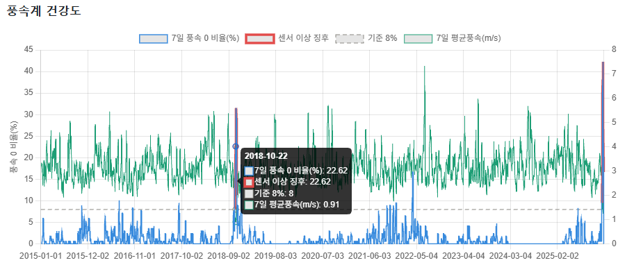
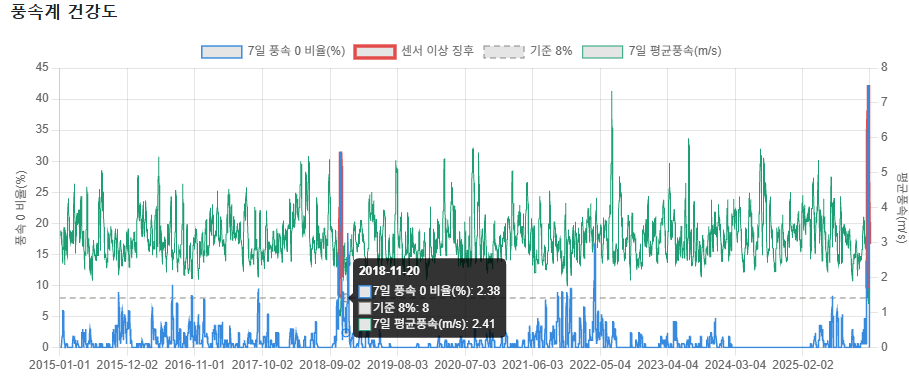
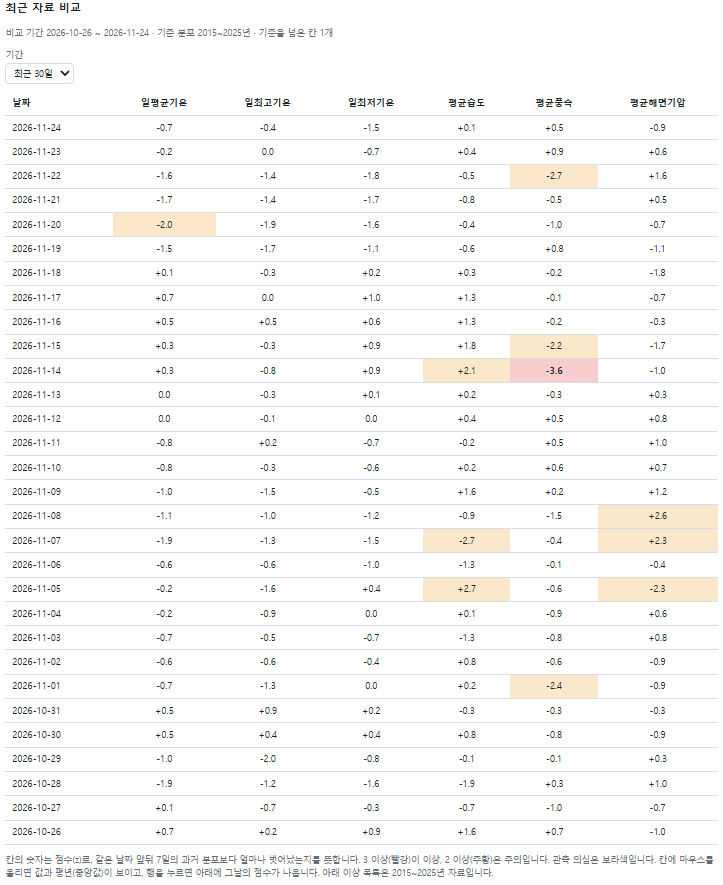

# KMA Anomaly · 기상 관측 자료 이상 패턴 탐지

기상청 API허브의 종관기상관측(ASOS) 시간자료 11년치(부산, 2015~2025, 96,409행)를 수집·정리하고, 같은 날짜의 과거 분포와 비교해 **이상 기상**과 **관측 장비 이상 징후**를 찾아 웹에서 보여주는 프로젝트입니다. 기상 관측 현업 경험을 바탕으로 결측 코드와 품질검사 규칙을 직접 설계했습니다.







## 무엇을 하나
- 기상청 API허브에서 과거 자료를 수집하고, 결측 코드를 물리 규칙으로 정리해 SQLite에 저장
- 같은 날짜 앞뒤 7일의 **다른 해** 분포(중앙값·MAD 기반 로버스트 z점수)와 비교해 일 단위 이상 탐지
- 이상을 **기상 이상**과 **관측 의심**으로 구분
- 풍속 0이 길게 이어지는 패턴으로 풍속계 건강도를 계산하고, 점검 기록(교체 2건)과 대조해 검증
- 올해 자료(1월 1일부터 전일까지)를 과거 기준 분포와 비교하는 **최근 자료 비교**와, 명령 한 번으로 갱신하는 스크립트
- FastAPI 조회 API와 웹 대시보드 제공

## 결과 요약
- 점수 24,085건 중 221건(0.9%)이 기준(|z| 3 이상)을 넘었고, 기상 이상 178건, 관측 의심 11건, 저풍속(정상 범위) 32건으로 분류
- 기압 급락(태풍 시기), 한파, 긴 장마, 늦더위 같은 실제 사건이 상위에 올라옴
- 풍속계 이상 징후로 판정한 2개 구간(2018-10, 2025-12)이 점검 기록의 교체 이력과 일치. 교체 전 2주간 풍속 0 비율이 15~36%까지 올랐다가 교체 직후 평소 수준으로 복귀
- 올해 자료 323일을 2015-2025년 기준 분포와 비교해 기준 초과 10건(기상 이상 7건, 저풍속 3건)을 찾았고, 관측 기록을 경신한 2026-07-29 일최고기온 38.5℃가 점수 +4.1로 탐지됨. 올해 풍속계는 정상

## 데이터 처리에서 해결한 문제
- 결측 코드(`-9`, `-9.0`, `-99`)가 실제 관측값과 겹침: 기온·습도로 이슬점을 계산해 비교하고, 지면온도는 기온과 대조하고, 3시간 간격 관측 요소는 관측 구조를 이용해 판별
- 강수 `불명` 2,030행을 0으로 채우지 않고, 습도·시정 분포가 비 온 시간과 비슷함을 확인해 불명으로 유지
- 치우친 풍속 분포: 로그 변환으로 점수 왜곡 완화
- 지속성 검사: 단발 정온을 센서 이상으로 오판정하는 문제를 발견하고, 판정 기준을 이동창 길이보다 길게(8일 이상) 수정

## 기술 스택
Python(requests, pandas, numpy) · SQLite · FastAPI · Chart.js · WSL2(Ubuntu) · Git/GitHub

## 한계와 향후 계획
- 단일 지점(부산 159), 일 단위 분석이며 시간 단위 분석과 여러 지점 확대는 미구현
- 센서 이상 징후 기준은 교체 이력 2건으로 확인한 후향 분석이라 일반화에 한계가 있음
- |z| 3 이상 기준과 요소별 점수를 합친 종합 점수는 추가 검증이 필요
- 최근 자료 비교는 요소별 점수만 사용하며 여러 요소를 합친 종합 점수는 미구현(예: 2026-07-29는 일최고기온만 기준을 넘고 일평균기온은 +2.1)

## 자료 출처
기상청 API허브(종관기상관측 시간자료). 원자료와 DB 파일은 저장소에 포함하지 않으며, 아래 실행 방법으로 직접 수집할 수 있습니다.

## 분석 상세: 데이터 품질 규칙과 검증
기상청 시간자료는 결측을 `-9`, `-9.0`, `-99.0` 등으로 표기하며, 일부는 실제 관측값과 겹칩니다. 원본(`asos_hourly`)은 보존하고 아래 규칙을 적용한 정리본(`asos_hourly_clean`)을 만듭니다.

| 규칙 | 대상 | 처리 |
|---|---|---|
| R1 | 기온류 `-99` 계열 | 결측 |
| R2 | 이슬점 `-9.0` | 기온·습도로 계산한 이슬점과 1도 이내면 실제값, 아니면 결측 |
| R3 | 지면온도 `-9.0` | 기온 0도 이상이면 결측 |
| R4 | 기압변화량 `-9.0` | 결측(3시간 간격 관측이라 나머지 시각은 비어 있음. 기압변화경향이 있는 8행도 현지기압 변화와 맞지 않아 결측) |
| R5 | 강수량 | 무강수(IR=3)는 0mm, 값이 있으면 관측, 그 외는 `RN_STATUS=불명` |
| R6 | 풍속 0 연속 | 8시간 이상 이어지면 `WS_SUSPECT=1`(관측 의심)로 표시, 값은 유지(지속성 검사) |

### 추가 검증 결과
- 기온 `-9.0` 3건(2018년 1\~2월 한파): 앞뒤 시각 기온(-8.3\~-9.6℃)과 이어지고 이슬점도 맞아 **실제값으로 유지**
- 강수 `불명`(RN 없음, 무강수 표시도 아님) 2,030행: 습도·시정·운량이 비 온 시간과 비슷하고 무강수 시간과 달라 **0mm로 채우지 않고 불명으로 유지**
- 무강수(IR=3)인데 RN>0인 126행: 대부분 0.1~1.0mm의 소량이라 측정값(RN)을 신뢰
- 빠진 시각(2015-2025년 23개, 최장 9시간): 보간하지 않으며, 일 단위 집계는 유효 시간 20시간 이상인 날만 사용. 올해는 2026-01-30부터 02-03까지 99시간이 연속으로 빠졌고(장비 장애 점검) 같은 규칙으로 해당 5일을 비교에서 제외

### 풍속계 이상 징후 검증 (R6)
- 풍속 0이 연속 8시간 이상인 구간 13건 중 10건이 2018-10~11, 2025-12에 집중됨
- 부산 관측소 점검 기록(2018-10-27 풍속계 파손 교체, 2025-12-26 베어링 교체)과 일치. 두 번 모두 교체 전에 월간 풍속 0 비율이 12~14%까지 상승(평소 중앙값 0.7%)
- 확인된 사례가 2건이라 일반화에는 한계가 있음
- 점검 기록이 없는 3건(2016-10, 2021-12, 2022-04)의 긴 정온은 점검 기록 확인 결과 고장 이력이 없어 자연 정온으로 판단. R6는 하루 단위 조건이라 이런 자연 정온을 '관측 의심'으로 오분류할 수 있음(예: 2021-12-05)

### 풍속계 건강도 지표
- 주 단위(574주) 점검: 풍속 0 비율 8% 이상 주는 14주(상위 약 2.4%). 점검 기록이 있는 5주는 2~3주 연속, 기록이 없는 8주는 모두 단발
- 지표: 매일 직전 7일(168시간)의 풍속 0 비율과 평균풍속을 계산, 비율 8% 이상이 8일 이상 연속되면 '센서 이상 징후'
- 한계: 기준은 교체 이력 2건을 확인한 뒤 정했으므로 다른 유형의 고장까지 잡는다고 일반화할 수 없음. 이동창이라 교체 후 최대 7일간 경보가 남음

### 풍속계 건강도 검증 결과
- 징후 판정 2건(2018-10-15\~31, 2025-12-16\~29)은 풍속계 교체 이력(2018-10-27, 2025-12-26)과 일치
- 설계 수정: 처음에는 7일 이상 연속을 기준으로 해서 단발 정온 2건(2018-11-29, 2022-04-03)이 오판정됨. 단발 1회는 7일 창에서 최대 7일만 지속하므로 기준을 8일 이상으로 상향. 2022-04 구간은 기상청 지속한계 초과 경보와 같은 시간대였고 정비 없이 자동 소멸
- 실시간 경보는 8일째에 나가므로 교체 5일 전(2018), 3일 전(2025). 후향 분석이며 사례가 2건이라 일반화에는 한계

## 실행 방법
```bash
python3 -m venv .venv && source .venv/bin/activate
pip install -r requirements.txt
cp .env.example .env          # KMA_AUTH_KEY에 기상청 API허브 인증키 입력

python collector/fetch_asos_hourly.py 159 2015 2025   # 과거 자료 수집
python collector/load_asos_to_db.py                   # 파싱 후 SQLite 적재
python collector/clean_asos.py                        # 결측 정리(R1~R6)
python analysis/anomaly_daily.py                      # 일 단위 이상 탐지
python analysis/sensor_health.py                      # 풍속계 건강도

uvicorn app.main:app --host 127.0.0.1 --port 8000     # http://localhost:8000
```

## 최근 자료 갱신
올해 1월 1일부터 어제까지의 자료를 받아 2015-2025년 기준 분포와 비교합니다. 기준 분포는 고정되어 있어 과거 결과는 바뀌지 않습니다. 실행은 `./update_recent.sh` 한 줄이며 수집, 적재, 정리, 비교, 풍속계 건강도 계산을 차례로 수행합니다.

## API
| 주소 | 설명 |
|---|---|
| `/` | 대시보드 |
| `/docs` | API 문서(Swagger) |
| `/api/summary` | 구분별 건수, 센서 경보 일수, 자료 기간 |
| `/api/anomalies` | 이상 목록(기간·요소·구분 필터) |
| `/api/anomalies/{date}` | 그날의 요소별 점수 |
| `/api/sensor-health` | 풍속계 건강도 일별 값 |
| `/api/recent` | 올해 자료의 최근 N일 점수(기준 분포와 비교) |
